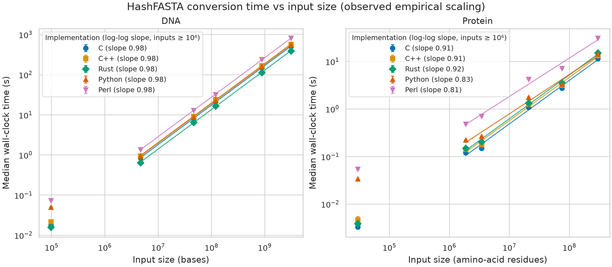

# HashFASTA

FASTA identifiers are not always unique: two records can share the same first identifier while containing different sequences. HashFASTA converts each record to a sequence-keyed FASTA record and preserves the original definition line as metadata, so downstream tools and agents can distinguish sequences reliably.

The draft v0.1 format writes gzip-compressed files named `*.hash.fasta.gz`. It accepts plain, gzip/BGZF, bzip2, or xz FASTA input and streams gzip output.

- [Draft specification v0.1](spec/HASHFASTA-v0.1.md)
- [Implementation issue](https://github.com/linsalrob/HashFASTA/issues/1)
- [Compressed test fixtures and provenance](tests/data/README.md)

## Runtime and scaling

The five implementations have been benchmarked on DNA and protein FASTA inputs, from a 97 kbp crAssphage genome to the 3.10 Gbp human GRCh38 primary assembly, and from small proteomes to 296 million protein residues. The figure shows median wall time against input size; each line is one implementation.



[Full benchmark report](benchmarks/REPORT.md) · [Benchmark data, figure, and scripts](benchmarks/)

On the largest inputs, the measured results were:

| Implementation | Human GRCh38, 3.10 Gbp | Peak RSS | BUSCO vertebrata, 296 M aa | Peak RSS |
| --- | ---: | ---: | ---: | ---: |
| Rust | 390 s (7.9 Mbp/s) | 240 MiB | 15.1 s (19.6 M aa/s) | ≤ 4 MiB |
| C | 504 s (6.1 Mbp/s) | 241 MiB | 11.3 s (26.1 M aa/s) | ≤ 4 MiB |
| Python | 558 s (5.6 Mbp/s) | 1383 MiB | 14.3 s (20.7 M aa/s) | 17 MiB |
| C++ | 571 s (5.4 Mbp/s) | 245 MiB | 13.1 s (22.5 M aa/s) | ≤ 4 MiB |
| Perl | 815 s (3.8 Mbp/s) | 489 MiB | 31.0 s (9.6 M aa/s) | 12 MiB |

All five produced byte-identical decompressed output for every benchmark input. For DNA, the empirical log-log runtime slopes were approximately 0.98 for every implementation on inputs of at least one million bases, consistent with linear scaling over the measured range. Protein results also trend close to linear, but the slope estimates are less conclusive: protein datasets differ in both record count and record length, and confidence intervals for C, C++, and Rust include 1. Runtime rankings also differ by workload: Rust was fastest on the full human genome, while C was fastest on the largest protein set.

Memory use is driven mainly by the longest individual sequence, which each implementation must hold while hashing it. In these measurements the compiled tools used about 240 MiB on human chr1–4; Python used more memory (1.38 GiB on the full human input). These are results from one Setonix benchmark and are not universal performance guarantees. The report documents hardware, toolchains, measurement method, confidence intervals, and caveats.

## Convert a FASTA file

Use whichever implementation is available. Python and Perl need no compiled build.

```sh
# Python, installed with pip (Python >= 3.9): command and library
pip install "git+https://github.com/linsalrob/HashFASTA#subdirectory=implementations/python"
hashfasta sample.fasta.gz

# Python 3.6+ straight from a checkout, no install (standard library only)
python3 implementations/python/run_hashfasta.py sample.fasta.gz

# Perl 5 (core modules only)
perl implementations/perl/hashfasta.pl sample.fasta.gz

# Compiled versions (build first; see below)
implementations/rust/target/release/hashfasta sample.fasta.gz
implementations/c/hashfasta sample.fasta.gz
implementations/cpp/hashfasta sample.fasta.gz
```

Each command writes `sample.hash.fasta.gz` beside the input by default. All implementations use the same interface:

```text
hashfasta INPUT [-o OUTPUT]
```

| Invocation | Reads | Writes |
| --- | --- | --- |
| `hashfasta x.fasta` | `x.fasta` | `x.hash.fasta.gz` |
| `hashfasta x.fa.gz` | `x.fa.gz` | `x.hash.fasta.gz` |
| `hashfasta x.fna.bz2` | `x.fna.bz2` | `x.hash.fasta.gz` |
| `hashfasta x.faa.xz` | `x.faa.xz` | `x.hash.fasta.gz` |
| `hashfasta x.fa -o y.hash.fasta.gz` | `x.fa` | `y.hash.fasta.gz` |
| `hashfasta - < x.fa > y.hash.fasta.gz` | stdin | stdout |
| `hashfasta x.fa -o -` | `x.fa` | stdout |

## Output and input rules

An output record has a SHA-256 key and the original full definition line in brackets:

```text
>sha256_<SHA-256 of normalized sequence> [<original definition line, with \\ [ ] escaped>]
<normalized sequence, wrapped at 80 columns>
```

The first token is the record identity. Identical sequences have identical keys; duplicate records are retained.

- Compression is detected from file contents, not the filename. Gzip/BGZF, bzip2, and xz inputs are supported, including concatenated members/streams. zstd and ZIP are not supported.
- Output is always gzip. Read it with `gzip -cd file.hash.fasta.gz` or `zcat`.
- The default output name removes one compression suffix and one recognized FASTA suffix, then adds `.hash.fasta.gz`.
- Sequence whitespace is removed and lowercase letters are uppercased. Output lines use Unix line endings and are wrapped at 80 columns.
- Lines beginning with `;` are comments and are dropped; a semicolon elsewhere in a sequence is an error.
- The input is never modified. Output is written to a temporary sibling and renamed only after a successful conversion.
- Invalid input and I/O errors exit non-zero. Invalid input includes empty records, sequence text before the first header, non-ASCII or non-printable sequence bytes, empty files, and corrupt or truncated compressed streams.

See the [specification](spec/HASHFASTA-v0.1.md) for the complete normalization and escaping rules.

## Build

| Language | Requirements | Build |
| --- | --- | --- |
| Python | Python ≥ 3.6 from checkout; ≥ 3.9 for `pip install` | none, or `pip install implementations/python` |
| Perl | Perl 5 core modules; `xz` command for xz input | none |
| Rust | Cargo, C compiler, and dependencies in Cargo manifest | `cargo build --release --manifest-path implementations/rust/Cargo.toml` |
| C | C99 compiler, zlib, libbz2, liblzma headers | `make -C implementations/c` |
| C++ | C++17 compiler, zlib, libbz2, liblzma headers | `make -C implementations/cpp` |

On Debian/Ubuntu, C and C++ builds need `zlib1g-dev libbz2-dev liblzma-dev`. Run `make build` at the repository root to build all compiled versions.

## Test

```sh
make test
python3 tests/run_conformance.py           # all implementations (already built)
python3 tests/run_conformance.py c perl    # selected implementations
python3 tests/run_conformance.py --cmd /path/to/tool
python3 -m unittest discover -s implementations/python/tests
```

The shared conformance runner checks expected outputs, compressed and plain input modes, stdin, output naming, malformed files, and byte-identical cross-implementation output. CI builds and tests the implementations on pushes and pull requests.
