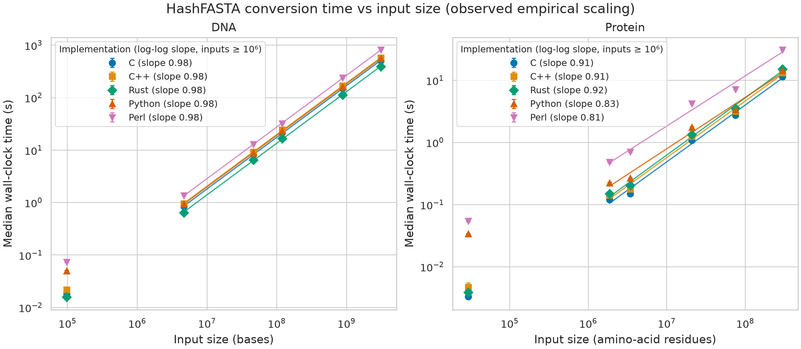

# HashFASTA runtime benchmark

Wall-clock time, throughput and peak memory of the five implementations
converting DNA and protein FASTA of increasing size (issue #3). All numbers
come from [`results/`](results/); the scripts that produced them are listed in
[`README.md`](README.md).

([SVG](results/runtime_scaling.svg))

## Method

- **Code:** commit `5e4b4ac` (main after PR #2), built with `make build`.
- **Inputs:** 6 DNA and 6 protein inputs, each a gzip FASTA (level 6) built by
  `prepare_inputs.py` ([`results/inputs.csv`](results/inputs.csv)).
  - DNA ranges from the 97 kbp crAssphage fixture, through E. coli K-12, a set
    of 8 bacterial genomes and Arabidopsis thaliana, to human GRCh38: chr1–4
    (880 Mbp) and the complete primary assembly (3.10 Gbp, 194 records).
  - Protein ranges from the 80 crAssphage CDS translations, through the
    P. aeruginosa PAO1 proteome, AMRFinderPlus reference proteins and the
    A. thaliana proteome, to the BUSCO vertebrata_odb10 RefSeq proteins: a
    75 M-residue prefix and the complete set (296 M residues, 510,639 records).
  - The human genome was already on the system, so nothing was downloaded.
    Source paths stay in an uncommitted local file;
    [`datasets.example.json`](datasets.example.json) shows the layout.
- **Allocation:** one Slurm array element per implementation (job 52209219), on
  the Setonix `work` partition (AMD EPYC 7763), with identical requests:
  - 24 GB memory, 1 task. Slurm raised the 2 requested CPUs to 14 cores to
    match the memory, so every implementation had the same 14 cores.
  - Every converter is single-threaded: for runs over 1 s, median CPU time is
    within 0.2% of wall time.
  - Inputs were copied to node-local storage first, and outputs were written
    there.
- **Runs:** for each input, 1 warm-up and then 3 timed runs.
  - A small C launcher (`runstat.c`) measures wall time with
    `CLOCK_MONOTONIC` around the converter process alone, and reads CPU time
    and peak RSS from `wait4`.
  - Each output was decompressed and hashed with SHA-256 after its run, outside
    the timed interval.
- **Validation:** every run of every input, across all 5 implementations,
  produced byte-identical decompressed output (`analyze.py` checks this before
  summarising).
- **Toolchains:**
  - C: gcc 14.3.0.
  - C++: the system `c++`, GCC 7.5.0. This is what the Makefile picks up, so
    C++ was not built with the newer compiler C used.
  - Rust: rustc 1.96.0.
  - Python: 3.11.17.
  - Perl: 5.26.1.

## Results at the largest inputs

Median of 3 timed runs. Throughput is input residues per second of wall time.

| Implementation | Human GRCh38 (3.10 Gbp) | Mbp/s | Peak RSS | BUSCO vertebrata (296 M aa) | M aa/s | Peak RSS |
| --- | ---: | ---: | ---: | ---: | ---: | ---: |
| Rust | 390 s | 7.9 | 240 MiB | 15.1 s | 19.6 | ≤ 4 MiB |
| C | 504 s | 6.1 | 241 MiB | 11.3 s | 26.1 | ≤ 4 MiB |
| Python | 558 s | 5.6 | 1383 MiB | 14.3 s | 20.7 | 17 MiB |
| C++ | 571 s | 5.4 | 245 MiB | 13.1 s | 22.5 | ≤ 4 MiB |
| Perl | 815 s | 3.8 | 489 MiB | 31.0 s | 9.6 | 12 MiB |

Every implementation, input and run is in
[`results/summary.csv`](results/summary.csv). For runs over 1 s, the 3 timed
runs spanned under 2% of the median in 26 of 36 cells and at most 7% (Rust,
full human).

Observations:

- **DNA:** Rust is fastest, about 1.3× faster than C. C, Python and C++ fall
  within 13% of each other, and Perl is about 1.6× slower than C. Python keeps
  up because its hashing, decompression and compression run in CPython's C
  extensions.
- **Protein:** the order changes. C leads, and Rust is slowest of the compiled
  implementations. Protein inputs have many short records, so per-record
  overhead matters more than per-base speed. This benchmark does not isolate
  which per-record step costs Rust the most.
- **Memory follows the longest record, not the file.** Every output header
  carries the hash of the whole sequence, so each implementation holds one
  record in memory.
  - Human chr1 has 249 Mbp. The compiled implementations peak near 1 byte per
    base of it (≈ 240 MiB), Perl near 2 bytes and Python near 5.6 bytes.
  - Python's extra copies come from joining lines, uppercasing and hashing.
  - Peak memory on the 3.10 Gbp genome equals that on chr1–4, and protein
    inputs stay at a few MiB however large the file is.

## Empirical scaling

These are least-squares fits of log10(median time) on log10(residues), with a
95% confidence interval on the slope from the t distribution
([`results/scaling_fits.csv`](results/scaling_fits.csv)). They describe the
inputs measured here. They are not a complexity proof.

| Panel | Implementation | Slope, inputs ≥ 10⁶ (95% CI), n = 5 | Slope, all inputs (95% CI), n = 6 |
| --- | --- | --- | --- |
| DNA | C | 0.98 (0.97–1.00) | 0.99 (0.98–1.00) |
| DNA | C++ | 0.98 (0.97–1.00) | 0.98 (0.98–0.99) |
| DNA | Rust | 0.98 (0.96–1.00) | 0.98 (0.97–0.99) |
| DNA | Python | 0.98 (0.97–0.99) | 0.91 (0.83–0.99) |
| DNA | Perl | 0.98 (0.97–1.00) | 0.91 (0.83–0.99) |
| Protein | C | 0.92 (0.78–1.05) | 0.88 (0.81–0.95) |
| Protein | C++ | 0.91 (0.78–1.04) | 0.86 (0.78–0.94) |
| Protein | Rust | 0.92 (0.82–1.03) | 0.89 (0.84–0.95) |
| Protein | Python | 0.83 (0.66–1.00) | 0.66 (0.47–0.84) |
| Protein | Perl | 0.81 (0.64–0.97) | 0.69 (0.55–0.83) |

- **DNA:** time grows linearly with size for every implementation.
- **The smallest inputs pull the all-input fits down.** Start-up cost
  dominates there: interpreter launch is about 35–70 ms for Python and Perl,
  against under 25 ms for the compiled programs. That is why the figure draws
  the fit over inputs ≥ 10⁶ only.
- **Protein slopes sit below 1** because the protein inputs differ in record
  length as well as count. Average throughput rises from the bacterial sets to
  the vertebrate proteins, and the intervals are wide with only 5 points. The
  confidence intervals include 1 for C, C++ and Rust. For Python and Perl the
  upper bounds are 0.995 and 0.97, which reflects their larger fixed cost per
  run and the throughput change between datasets, not a sub-linear algorithm.

## Caveats

- **Peak RSS for small runs is unreliable.** On this kernel (6.4) `ru_maxrss`
  comes from approximate per-CPU counters, so it can read up to a few MiB low.
  It reads 0 for some short C and Rust runs, which is why the table says
  "≤ 4 MiB". The large-input values are well above this error.
- **One node per implementation.** Rust and Python ran on the same node,
  while C, C++ and Perl each had a different node. All were the same CPU model,
  partition and allocation, and spread between repetitions was small, but
  node-to-node variation is not measured separately.
- **Different compiler generations.** C used gcc 14 and C++ used GCC 7.5. The
  C++ result reflects the default build, not the best possible C++ build.
